# MindSync Relational Database Schema & Architecture

This document specifies the complete relational schema design for **MindSync – AI-Powered Mental Wellness and Personalized Support Platform**. The schema supports end-to-end data integrity, strict audit logs, personalized baseline tracking, facial blendshape records, multimodal stress indicators, appointment management, and GDPR/DPDP-compliant data erasure.

---

## 1. Entity-Relationship (ER) Diagram

```mermaid
erDiagram
    USERS ||--o{ USER_SESSIONS : "has"
    USERS ||--o{ USER_ROUTINES : "defines"
    USERS ||--o{ EMOTION_LOGS : "records"
    USERS ||--o{ BEHAVIOR_LOGS : "logs"
    USERS ||--o{ BEHAVIOR_BASELINES : "maintains"
    USERS ||--o{ SCREEN_TIME_LOGS : "accumulates"
    USERS ||--o{ WELLNESS_ACTIVITIES : "performs"
    USERS ||--o{ JOURNAL_ENTRIES : "writes"
    USERS ||--o{ APPOINTMENTS : "books"
    USERS ||--o{ EMERGENCY_CONTACTS : "configures"
    USERS ||--o{ AUDIT_LOGS : "audits"

    PROVIDERS ||--o{ PROVIDER_SLOTS : "schedules"
    PROVIDERS ||--o{ APPOINTMENTS : "attends"
    APPOINTMENTS ||--o| TELEHEALTH_SESSIONS : "initiates"
    TELEHEALTH_SESSIONS ||--o{ CONSULTATION_NOTES : "contains"

    USERS {
        UUID id PK
        VARCHAR name
        VARCHAR email UK
        VARCHAR password_hash
        INTEGER age
        VARCHAR gender
        VARCHAR location
        VARCHAR preferred_language
        BOOLEAN camera_permitted
        BOOLEAN usage_tracking_permitted
        BOOLEAN keystroke_tracking_permitted
        TIMESTAMP created_at
        TIMESTAMP updated_at
    }

    USER_SESSIONS {
        UUID id PK
        UUID user_id FK
        VARCHAR session_token UK
        TIMESTAMP created_at
        TIMESTAMP expires_at
        BOOLEAN is_active
    }

    USER_ROUTINES {
        UUID id PK
        UUID user_id FK
        TIME typical_wake_time
        TIME typical_sleep_time
        INTEGER target_screen_hours
        INTEGER max_continuous_hours
        BOOLEAN quiet_hours_enabled
        TIME quiet_hours_start
        TIME quiet_hours_end
        TIMESTAMP updated_at
    }

    EMOTION_LOGS {
        UUID id PK
        UUID user_id FK
        VARCHAR detected_emotion
        FLOAT confidence_score
        JSON blendshape_coefficients
        BOOLEAN user_confirmed
        VARCHAR user_corrected_emotion
        VARCHAR context_trigger
        TIMESTAMP recorded_at
    }

    BEHAVIOR_BASELINES {
        UUID id PK
        UUID user_id FK
        FLOAT baseline_wpm
        FLOAT baseline_backspace_rate
        FLOAT baseline_hesitation_pause_sec
        INTEGER sample_size_keystrokes
        TIMESTAMP last_calibrated_at
    }

    BEHAVIOR_LOGS {
        UUID id PK
        UUID user_id FK
        FLOAT current_wpm
        FLOAT backspace_rate
        FLOAT hesitation_pauses
        FLOAT deviation_score
        BOOLEAN stress_anomaly_flag
        TIMESTAMP recorded_at
    }

    SCREEN_TIME_LOGS {
        UUID id PK
        UUID user_id FK
        VARCHAR app_category
        INTEGER duration_minutes
        DATE log_date
        BOOLEAN exceeded_continuous_limit
        BOOLEAN during_sleep_window
    }

    WELLNESS_ACTIVITIES {
        UUID id PK
        UUID user_id FK
        VARCHAR activity_type
        INTEGER duration_seconds
        INTEGER stress_pre_score
        INTEGER stress_post_score
        TIMESTAMP completed_at
    }

    JOURNAL_ENTRIES {
        UUID id PK
        UUID user_id FK
        VARCHAR mood_tag
        TEXT encrypted_content
        VARCHAR ai_sentiment_valence
        TIMESTAMP created_at
    }

    PROVIDERS {
        UUID id PK
        VARCHAR full_name
        VARCHAR specialization
        VARCHAR qualification
        FLOAT experience_years
        FLOAT consultation_fee
        VARCHAR location_city
        FLOAT latitude
        FLOAT longitude
        FLOAT rating
        BOOLEAN is_verified
        VARCHAR languages_spoken
    }

    PROVIDER_SLOTS {
        UUID id PK
        UUID provider_id FK
        DATE slot_date
        TIME start_time
        TIME end_time
        BOOLEAN is_booked
    }

    APPOINTMENTS {
        UUID id PK
        UUID user_id FK
        UUID provider_id FK
        DATE appointment_date
        TIME appointment_time
        VARCHAR modality
        VARCHAR status
        TEXT reason_for_visit
        TIMESTAMP created_at
    }

    TELEHEALTH_SESSIONS {
        UUID id PK
        UUID appointment_id FK
        VARCHAR room_id UK
        TIMESTAMP start_time
        TIMESTAMP end_time
        VARCHAR call_status
        BOOLEAN e2e_encrypted
    }

    CONSULTATION_NOTES {
        UUID id PK
        UUID telehealth_session_id FK
        TEXT doctor_observations
        TEXT recommendations
        TEXT follow_up_plan
        TIMESTAMP written_at
    }

    EMERGENCY_CONTACTS {
        UUID id PK
        UUID user_id FK
        VARCHAR contact_name
        VARCHAR relationship
        VARCHAR phone_number
        BOOLEAN notify_on_crisis
    }

    AUDIT_LOGS {
        UUID id PK
        UUID user_id FK
        VARCHAR action_type
        VARCHAR ip_hash
        TEXT metadata
        TIMESTAMP timestamp
    }
```



---

## 2. Table Specifications

### Table 1: `users`
Core demographic, credential, and permission profile. Does not store unnecessary invasive telemetry.
- `id` (UUID, Primary Key): Unique identifier.
- `name` (VARCHAR(120), NOT NULL): User's legal or chosen name.
- `email` (VARCHAR(255), UNIQUE, NOT NULL): Identity for credentials and session resets.
- `password_hash` (VARCHAR(255), NOT NULL): Hex-encoded SHA-256 (or Argon2id) salted password hash.
- `age` (INTEGER, CHECK > 0 AND < 120): Demographic context for age-appropriate wellness routines.
- `gender` (VARCHAR(50)): User-specified gender identity.
- `location` (VARCHAR(150)): City/Region used for local mental health provider matching.
- `preferred_language` (VARCHAR(50), DEFAULT 'English'): Localization preference.
- `camera_permitted` (BOOLEAN, DEFAULT FALSE): Master explicit toggle for video landmarker feed.
- `usage_tracking_permitted` (BOOLEAN, DEFAULT FALSE): Opt-in for screen time monitor.
- `keystroke_tracking_permitted` (BOOLEAN, DEFAULT FALSE): Opt-in for in-app cadence analysis.
- `created_at` (TIMESTAMP, DEFAULT CURRENT_TIMESTAMP)
- `updated_at` (TIMESTAMP, DEFAULT CURRENT_TIMESTAMP)

### Table 2: `user_sessions`
Active cryptographically random session tokens.
- `id` (UUID, Primary Key)
- `user_id` (UUID, Foreign Key -> `users.id` ON DELETE CASCADE)
- `session_token` (VARCHAR(128), UNIQUE, NOT NULL): CSPRNG hex token.
- `created_at` (TIMESTAMP, DEFAULT CURRENT_TIMESTAMP)
- `expires_at` (TIMESTAMP, NOT NULL): Session expiration (typically 7 to 30 days).
- `is_active` (BOOLEAN, DEFAULT TRUE): Instant invalidation upon user logout.

### Table 3: `user_routines`
Circadian schedule and device usage boundaries.
- `id` (UUID, Primary Key)
- `user_id` (UUID, Foreign Key -> `users.id` ON DELETE CASCADE)
- `typical_wake_time` (TIME, DEFAULT '07:00:00')
- `typical_sleep_time` (TIME, DEFAULT '23:00:00')
- `target_screen_hours` (INTEGER, DEFAULT 4): Recommended daily device cap.
- `max_continuous_hours` (INTEGER, DEFAULT 2): Maximum continuous uninterrupted session before 20-20-20 break.
- `quiet_hours_enabled` (BOOLEAN, DEFAULT TRUE): Suppresses non-critical notifications during sleep.
- `quiet_hours_start` (TIME, DEFAULT '22:30:00')
- `quiet_hours_end` (TIME, DEFAULT '07:00:00')
- `updated_at` (TIMESTAMP, DEFAULT CURRENT_TIMESTAMP)

### Table 4: `emotion_logs`
Privacy-preserved facial state telemetry. Raw video frames are **never stored**.
- `id` (UUID, Primary Key)
- `user_id` (UUID, Foreign Key -> `users.id` ON DELETE CASCADE)
- `detected_emotion` (VARCHAR(50), NOT NULL): Enum: Neutral, Happy, Sad, Angry, Fearful, Surprised, Stressed/Tense.
- `confidence_score` (FLOAT, CHECK between 0.0 and 1.0): Classifier certainty metric.
- `blendshape_coefficients` (JSONB / JSON): FACS Action Units snapshot (AU1 to AU26).
- `user_confirmed` (BOOLEAN, DEFAULT NULL): User feedback ('Correct' / 'Not Correct').
- `user_corrected_emotion` (VARCHAR(50), NULL): True ground-truth label provided by the user.
- `context_trigger` (VARCHAR(100)): 'Manual Check-in', 'Pre-Session', 'Post-Session', etc.
- `recorded_at` (TIMESTAMP, DEFAULT CURRENT_TIMESTAMP)

### Table 5: `behavior_baselines`
Personalized statistical baseline for in-app typing cadence. Prevents false alarms across fast vs slow typists.
- `id` (UUID, Primary Key)
- `user_id` (UUID, Foreign Key -> `users.id` ON DELETE CASCADE)
- `baseline_wpm` (FLOAT, DEFAULT 52.0): Normal typing speed.
- `baseline_backspace_rate` (FLOAT, DEFAULT 0.04): Normal error correction fraction (4%).
- `baseline_hesitation_pause_sec` (FLOAT, DEFAULT 0.85): Mean pause duration.
- `sample_size_keystrokes` (INTEGER, DEFAULT 1000): Number of strokes evaluated.
- `last_calibrated_at` (TIMESTAMP, DEFAULT CURRENT_TIMESTAMP)

### Table 6: `behavior_logs`
In-app typing session metrics compared against the baseline.
- `id` (UUID, Primary Key)
- `user_id` (UUID, Foreign Key -> `users.id` ON DELETE CASCADE)
- `current_wpm` (FLOAT)
- `backspace_rate` (FLOAT)
- `hesitation_pauses` (FLOAT)
- `deviation_score` (FLOAT): Z-score distance from personal baseline.
- `stress_anomaly_flag` (BOOLEAN, DEFAULT FALSE): Triggered when error rate or hesitation exceeds 2.0σ.
- `recorded_at` (TIMESTAMP, DEFAULT CURRENT_TIMESTAMP)

### Table 7: `screen_time_logs`
Aggregated app usage categories and health threshold checks.
- `id` (UUID, Primary Key)
- `user_id` (UUID, Foreign Key -> `users.id` ON DELETE CASCADE)
- `app_category` (VARCHAR(80)): Social, Productivity, Entertainment, Utility, Reading.
- `duration_minutes` (INTEGER, NOT NULL)
- `log_date` (DATE, NOT NULL)
- `exceeded_continuous_limit` (BOOLEAN, DEFAULT FALSE)
- `during_sleep_window` (BOOLEAN, DEFAULT FALSE)

### Table 8: `wellness_activities`
Therapeutic interventions executed (box breathing, grounding, 20-20-20 breaks).
- `id` (UUID, Primary Key)
- `user_id` (UUID, Foreign Key -> `users.id` ON DELETE CASCADE)
- `activity_type` (VARCHAR(80)): 'Box Breathing (4-4-4-4)', '4-7-8 Deep Relaxation', '5-4-3-2-1 Sensory Grounding', '20-20-20 Eye Relief'.
- `duration_seconds` (INTEGER)
- `stress_pre_score` (INTEGER, 1-10)
- `stress_post_score` (INTEGER, 1-10)
- `completed_at` (TIMESTAMP, DEFAULT CURRENT_TIMESTAMP)

### Table 9: `journal_entries`
User emotional reflections with local encryption.
- `id` (UUID, Primary Key)
- `user_id` (UUID, Foreign Key -> `users.id` ON DELETE CASCADE)
- `mood_tag` (VARCHAR(50))
- `encrypted_content` (TEXT, NOT NULL): Text stored locally / AES encrypted.
- `ai_sentiment_valence` (VARCHAR(30)): Positive, Neutral, Negative, Mixed.
- `created_at` (TIMESTAMP, DEFAULT CURRENT_TIMESTAMP)

### Table 10: `providers`
Verified mental healthcare professionals directory.
- `id` (UUID, Primary Key)
- `full_name` (VARCHAR(150), NOT NULL)
- `specialization` (VARCHAR(100)): 'Clinical Psychologist', 'Psychiatrist', 'Cognitive Behavioral Therapist', 'Family & Child Counselor'.
- `qualification` (VARCHAR(150)): M.Phil Clinical Psychology, MD Psychiatry, etc.
- `experience_years` (FLOAT)
- `consultation_fee` (FLOAT, CHECK between 500 AND 3000 INR)
- `location_city` (VARCHAR(100))
- `latitude` (FLOAT)
- `longitude` (FLOAT)
- `rating` (FLOAT, CHECK between 1.0 AND 5.0)
- `is_verified` (BOOLEAN, DEFAULT TRUE)
- `languages_spoken` (VARCHAR(200))

### Table 11: `provider_slots`
Available booking timeslots per provider.
- `id` (UUID, Primary Key)
- `provider_id` (UUID, Foreign Key -> `providers.id` ON DELETE CASCADE)
- `slot_date` (DATE, NOT NULL)
- `start_time` (TIME, NOT NULL)
- `end_time` (TIME, NOT NULL)
- `is_booked` (BOOLEAN, DEFAULT FALSE)

### Table 12: `appointments`
Session appointments booked by users with providers.
- `id` (UUID, Primary Key)
- `user_id` (UUID, Foreign Key -> `users.id` ON DELETE CASCADE)
- `provider_id` (UUID, Foreign Key -> `providers.id` ON DELETE CASCADE)
- `appointment_date` (DATE, NOT NULL)
- `appointment_time` (TIME, NOT NULL)
- `modality` (VARCHAR(20)): 'Virtual Telehealth' or 'In-Person Clinic'
- `status` (VARCHAR(20)): 'Confirmed', 'Rescheduled', 'Completed', 'Cancelled'
- `reason_for_visit` (TEXT)
- `created_at` (TIMESTAMP, DEFAULT CURRENT_TIMESTAMP)

### Table 13: `telehealth_sessions`
Encrypted WebRTC virtual consultation bridge.
- `id` (UUID, Primary Key)
- `appointment_id` (UUID, Foreign Key -> `appointments.id` ON DELETE CASCADE)
- `room_id` (VARCHAR(80), UNIQUE, NOT NULL)
- `start_time` (TIMESTAMP, NULL)
- `end_time` (TIMESTAMP, NULL)
- `call_status` (VARCHAR(30)): 'Waiting', 'In-Progress', 'Completed', 'Disconnected'
- `e2e_encrypted` (BOOLEAN, DEFAULT TRUE)

### Table 14: `consultation_notes`
Post-session clinical records created by the provider.
- `id` (UUID, Primary Key)
- `telehealth_session_id` (UUID, Foreign Key -> `telehealth_sessions.id` ON DELETE CASCADE)
- `doctor_observations` (TEXT)
- `recommendations` (TEXT)
- `follow_up_plan` (TEXT)
- `written_at` (TIMESTAMP, DEFAULT CURRENT_TIMESTAMP)

### Table 15: `emergency_contacts`
Personal safety net for emergency SOS triggers.
- `id` (UUID, Primary Key)
- `user_id` (UUID, Foreign Key -> `users.id` ON DELETE CASCADE)
- `contact_name` (VARCHAR(120), NOT NULL)
- `relationship` (VARCHAR(60))
- `phone_number` (VARCHAR(25), NOT NULL)
- `notify_on_crisis` (BOOLEAN, DEFAULT TRUE)

### Table 16: `audit_logs`
Cryptographic tamper-evident access log for GDPR/DPDP compliance.
- `id` (UUID, Primary Key)
- `user_id` (UUID, Foreign Key -> `users.id` ON DELETE SET NULL)
- `action_type` (VARCHAR(80), NOT NULL): 'USER_LOGIN', 'DATA_EXPORT', 'DATA_PURGE', 'PERMISSION_UPDATE', 'EMERGENCY_ACCESS'
- `ip_hash` (VARCHAR(64)): Anonymized SHA-256 client hash
- `metadata` (TEXT)
- `timestamp` (TIMESTAMP, DEFAULT CURRENT_TIMESTAMP)

---

## 3. SQL Data Definition Language (DDL) Script

```sql
-- ====================================================================
-- MINDSYNC RELATIONAL DATABASE DDL SCRIPT (POSTGRESQL / SQL-99 COMPATIBLE)
-- ====================================================================

-- 1. Users Table
CREATE TABLE users (
    id UUID PRIMARY KEY,
    name VARCHAR(120) NOT NULL,
    email VARCHAR(255) UNIQUE NOT NULL,
    password_hash VARCHAR(255) NOT NULL,
    age INTEGER CHECK (age > 0 AND age < 120),
    gender VARCHAR(50),
    location VARCHAR(150),
    preferred_language VARCHAR(50) DEFAULT 'English',
    camera_permitted BOOLEAN DEFAULT FALSE,
    usage_tracking_permitted BOOLEAN DEFAULT FALSE,
    keystroke_tracking_permitted BOOLEAN DEFAULT FALSE,
    created_at TIMESTAMP WITH TIME ZONE DEFAULT CURRENT_TIMESTAMP,
    updated_at TIMESTAMP WITH TIME ZONE DEFAULT CURRENT_TIMESTAMP
);

-- 2. User Sessions Table
CREATE TABLE user_sessions (
    id UUID PRIMARY KEY,
    user_id UUID NOT NULL REFERENCES users(id) ON DELETE CASCADE,
    session_token VARCHAR(128) UNIQUE NOT NULL,
    created_at TIMESTAMP WITH TIME ZONE DEFAULT CURRENT_TIMESTAMP,
    expires_at TIMESTAMP WITH TIME ZONE NOT NULL,
    is_active BOOLEAN DEFAULT TRUE
);

-- 3. User Routines Table
CREATE TABLE user_routines (
    id UUID PRIMARY KEY,
    user_id UUID NOT NULL REFERENCES users(id) ON DELETE CASCADE,
    typical_wake_time TIME NOT NULL DEFAULT '07:00:00',
    typical_sleep_time TIME NOT NULL DEFAULT '23:00:00',
    target_screen_hours INTEGER NOT NULL DEFAULT 4,
    max_continuous_hours INTEGER NOT NULL DEFAULT 2,
    quiet_hours_enabled BOOLEAN NOT NULL DEFAULT TRUE,
    quiet_hours_start TIME NOT NULL DEFAULT '22:30:00',
    quiet_hours_end TIME NOT NULL DEFAULT '07:00:00',
    updated_at TIMESTAMP WITH TIME ZONE DEFAULT CURRENT_TIMESTAMP
);

-- 4. Emotion Logs Table
CREATE TABLE emotion_logs (
    id UUID PRIMARY KEY,
    user_id UUID NOT NULL REFERENCES users(id) ON DELETE CASCADE,
    detected_emotion VARCHAR(50) NOT NULL,
    confidence_score FLOAT CHECK (confidence_score >= 0.0 AND confidence_score <= 1.0),
    blendshape_coefficients JSONB NOT NULL,
    user_confirmed BOOLEAN DEFAULT NULL,
    user_corrected_emotion VARCHAR(50) DEFAULT NULL,
    context_trigger VARCHAR(100) DEFAULT 'Direct Scan',
    recorded_at TIMESTAMP WITH TIME ZONE DEFAULT CURRENT_TIMESTAMP
);

-- 5. Behavior Baselines Table
CREATE TABLE behavior_baselines (
    id UUID PRIMARY KEY,
    user_id UUID NOT NULL REFERENCES users(id) ON DELETE CASCADE,
    baseline_wpm FLOAT NOT NULL DEFAULT 52.0,
    baseline_backspace_rate FLOAT NOT NULL DEFAULT 0.04,
    baseline_hesitation_pause_sec FLOAT NOT NULL DEFAULT 0.85,
    sample_size_keystrokes INTEGER NOT NULL DEFAULT 1000,
    last_calibrated_at TIMESTAMP WITH TIME ZONE DEFAULT CURRENT_TIMESTAMP
);

-- 6. Behavior Logs Table
CREATE TABLE behavior_logs (
    id UUID PRIMARY KEY,
    user_id UUID NOT NULL REFERENCES users(id) ON DELETE CASCADE,
    current_wpm FLOAT NOT NULL,
    backspace_rate FLOAT NOT NULL,
    hesitation_pauses FLOAT NOT NULL,
    deviation_score FLOAT NOT NULL DEFAULT 0.0,
    stress_anomaly_flag BOOLEAN NOT NULL DEFAULT FALSE,
    recorded_at TIMESTAMP WITH TIME ZONE DEFAULT CURRENT_TIMESTAMP
);

-- 7. Screen Time Logs Table
CREATE TABLE screen_time_logs (
    id UUID PRIMARY KEY,
    user_id UUID NOT NULL REFERENCES users(id) ON DELETE CASCADE,
    app_category VARCHAR(80) NOT NULL,
    duration_minutes INTEGER NOT NULL,
    log_date DATE NOT NULL,
    exceeded_continuous_limit BOOLEAN DEFAULT FALSE,
    during_sleep_window BOOLEAN DEFAULT FALSE
);

-- 8. Wellness Activities Table
CREATE TABLE wellness_activities (
    id UUID PRIMARY KEY,
    user_id UUID NOT NULL REFERENCES users(id) ON DELETE CASCADE,
    activity_type VARCHAR(80) NOT NULL,
    duration_seconds INTEGER NOT NULL,
    stress_pre_score INTEGER CHECK (stress_pre_score BETWEEN 1 AND 10),
    stress_post_score INTEGER CHECK (stress_post_score BETWEEN 1 AND 10),
    completed_at TIMESTAMP WITH TIME ZONE DEFAULT CURRENT_TIMESTAMP
);

-- 9. Journal Entries Table
CREATE TABLE journal_entries (
    id UUID PRIMARY KEY,
    user_id UUID NOT NULL REFERENCES users(id) ON DELETE CASCADE,
    mood_tag VARCHAR(50) NOT NULL,
    encrypted_content TEXT NOT NULL,
    ai_sentiment_valence VARCHAR(30) DEFAULT 'Neutral',
    created_at TIMESTAMP WITH TIME ZONE DEFAULT CURRENT_TIMESTAMP
);

-- 10. Providers Table
CREATE TABLE providers (
    id UUID PRIMARY KEY,
    full_name VARCHAR(150) NOT NULL,
    specialization VARCHAR(100) NOT NULL,
    qualification VARCHAR(150) NOT NULL,
    experience_years FLOAT NOT NULL,
    consultation_fee FLOAT CHECK (consultation_fee BETWEEN 500 AND 3000),
    location_city VARCHAR(100) NOT NULL,
    latitude FLOAT NOT NULL,
    longitude FLOAT NOT NULL,
    rating FLOAT CHECK (rating BETWEEN 1.0 AND 5.0),
    is_verified BOOLEAN DEFAULT TRUE,
    languages_spoken VARCHAR(200) NOT NULL
);

-- 11. Provider Slots Table
CREATE TABLE provider_slots (
    id UUID PRIMARY KEY,
    provider_id UUID NOT NULL REFERENCES providers(id) ON DELETE CASCADE,
    slot_date DATE NOT NULL,
    start_time TIME NOT NULL,
    end_time TIME NOT NULL,
    is_booked BOOLEAN DEFAULT FALSE
);

-- 12. Appointments Table
CREATE TABLE appointments (
    id UUID PRIMARY KEY,
    user_id UUID NOT NULL REFERENCES users(id) ON DELETE CASCADE,
    provider_id UUID NOT NULL REFERENCES providers(id) ON DELETE CASCADE,
    appointment_date DATE NOT NULL,
    appointment_time TIME NOT NULL,
    modality VARCHAR(30) CHECK (modality IN ('Virtual Telehealth', 'In-Person Clinic')),
    status VARCHAR(30) CHECK (status IN ('Confirmed', 'Rescheduled', 'Completed', 'Cancelled')),
    reason_for_visit TEXT,
    created_at TIMESTAMP WITH TIME ZONE DEFAULT CURRENT_TIMESTAMP
);

-- 13. Telehealth Sessions Table
CREATE TABLE telehealth_sessions (
    id UUID PRIMARY KEY,
    appointment_id UUID NOT NULL REFERENCES appointments(id) ON DELETE CASCADE,
    room_id VARCHAR(80) UNIQUE NOT NULL,
    start_time TIMESTAMP WITH TIME ZONE,
    end_time TIMESTAMP WITH TIME ZONE,
    call_status VARCHAR(30) DEFAULT 'Waiting',
    e2e_encrypted BOOLEAN DEFAULT TRUE
);

-- 14. Consultation Notes Table
CREATE TABLE consultation_notes (
    id UUID PRIMARY KEY,
    telehealth_session_id UUID NOT NULL REFERENCES telehealth_sessions(id) ON DELETE CASCADE,
    doctor_observations TEXT,
    recommendations TEXT,
    follow_up_plan TEXT,
    written_at TIMESTAMP WITH TIME ZONE DEFAULT CURRENT_TIMESTAMP
);

-- 15. Emergency Contacts Table
CREATE TABLE emergency_contacts (
    id UUID PRIMARY KEY,
    user_id UUID NOT NULL REFERENCES users(id) ON DELETE CASCADE,
    contact_name VARCHAR(120) NOT NULL,
    relationship VARCHAR(60) NOT NULL,
    phone_number VARCHAR(25) NOT NULL,
    notify_on_crisis BOOLEAN DEFAULT TRUE
);

-- 16. Audit Logs Table
CREATE TABLE audit_logs (
    id UUID PRIMARY KEY,
    user_id UUID REFERENCES users(id) ON DELETE SET NULL,
    action_type VARCHAR(80) NOT NULL,
    ip_hash VARCHAR(64) NOT NULL,
    metadata TEXT,
    timestamp TIMESTAMP WITH TIME ZONE DEFAULT CURRENT_TIMESTAMP
);

-- PERFORMANCE INDEXES
CREATE INDEX idx_user_sessions_token ON user_sessions(session_token);
CREATE INDEX idx_emotion_logs_user ON emotion_logs(user_id, recorded_at);
CREATE INDEX idx_screen_time_date ON screen_time_logs(user_id, log_date);
CREATE INDEX idx_appointments_user ON appointments(user_id, appointment_date);
CREATE INDEX idx_providers_geo ON providers(latitude, longitude);
CREATE INDEX idx_audit_user_action ON audit_logs(user_id, action_type);
```
