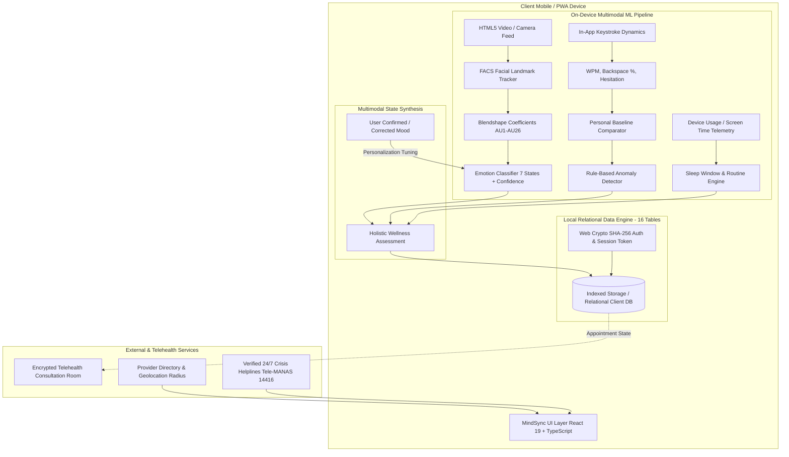
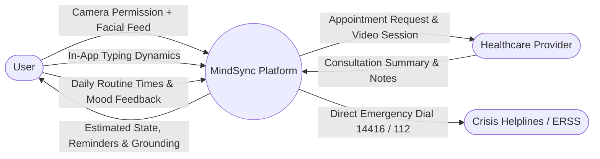
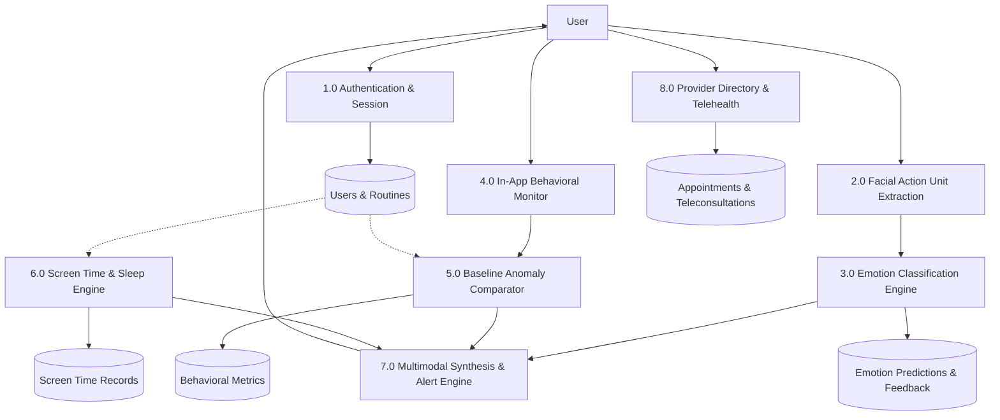
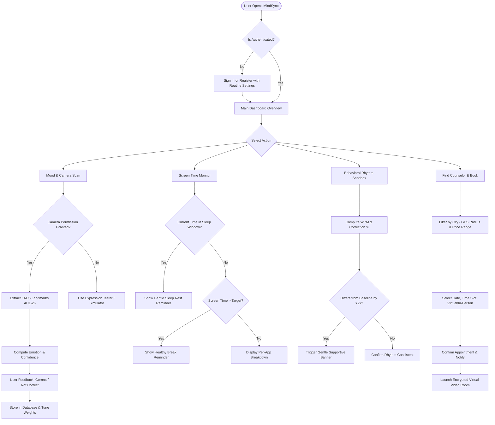

# MindSync: System Architecture & Technical Specifications

**Project Title:** MindSync – AI-Powered Mental Wellness and Personalized Support Platform  
**Academic Level:** College Final-Year Mini Project  
**Architecture Domain:** Privacy-Preserving Multimodal Mental Wellness & Telemedicine  

---

## 1. High-Level System Architecture

MindSync decouples client-side biometric inference from network communication, ensuring that all facial geometry and typing dynamics remain strictly on the user's device.

---

## 2. Module Architecture

The application is structured into 8 modular, loosely coupled subsystems:

| Module | Core Responsibility | Files |
| :--- | :--- | :--- |
| **Authentication & Profile** | User registration, SHA-256 client password hashing, session tokens, daily routine configuration | `src/context/AuthContext.tsx`, `src/utils/crypto.ts`, `src/components/profile/UserProfileView.tsx`, `src/components/auth/AuthModal.tsx` |
| **Relational Database** | 16-table relational schema abstraction, foreign-key relationships, CRUD, JSON export, and SQL DDL generator | `src/db/database.ts`, `src/types/index.ts` |
| **Camera & Facial ML** | WebCam video streaming, FACS geometric action unit extraction, emotion inference, confidence gauge, and user feedback loop | `src/ml/emotionClassifier.ts`, `src/components/camera/CameraEmotionEstimator.tsx` |
| **Mood Analytics** | Today's timeline, 7-day stacked trend graph, positive/neutral/tension ratios, subjective check-in logger | `src/components/mood/MoodTrendDashboard.tsx` |
| **Behavior Dynamics** | In-app typing test, WPM and correction rate tracking, personal baseline calibration, and multimodal anomaly alerts | `src/components/behavior/BehaviorStressTracker.tsx` |
| **Screen Time & Routine** | App duration tracking, multi-threshold warnings (4h/6h), sleep window evaluation, and quiet hours enforcement | `src/components/screentime/ScreenTimeMonitor.tsx` |
| **Wellness & Grounding** | Interactive box breathing (4-4-4-4) & 4-7-8 pacer, 5-4-3-2-1 grounding, 20-20-20 screen break, private journal | `src/components/wellness/WellnessToolkit.tsx` |
| **Healthcare & Telehealth** | Provider directory with location/radius filters, price range slider, booking modal, appointments manager, and mock teleconsultation | `src/components/directory/ProviderDirectory.tsx`, `src/components/appointments/`, `src/components/telehealth/` |
| **Crisis & Emergency** | Verified national 24/7 helplines (Tele-MANAS 14416, KIRAN, 112), trusted emergency contact manager | `src/components/emergency/EmergencySupport.tsx` |
| **Privacy & Sovereignty** | Sensor permission controls, data audit, GDPR export, and technical limitations matrix | `src/components/privacy/PrivacyCenter.tsx` |

---

## 3. Data-Flow Diagrams (DFD)

### DFD Level 0 (Context Diagram)

### DFD Level 1 (Subsystem Decomposition)

---

## 4. Application Flowchart

---

## 5. Mock REST API Specifications

The relational database engine supports the following API contracts:

### Authentication Endpoints
- `POST /api/v1/auth/register`
  - Body: `{ name, email, passwordPlain, age, gender, location, wakeUpTime, sleepTime }`
  - Response: `{ success: true, token: "ms_...", user: UserProfile }`
- `POST /api/v1/auth/login`
  - Body: `{ email, passwordPlain }`
  - Response: `{ success: true, token: "ms_...", user: UserProfile }`

### Telemetry & Inferences
- `POST /api/v1/ml/emotion-predictions`
  - Body: `{ detectedEmotion, confidenceScore, blendshapes }`
  - Response: `{ id: "pred-...", timestamp: "..." }`
- `PUT /api/v1/ml/emotion-predictions/:id/feedback`
  - Body: `{ isCorrect: boolean, correctedEmotion?: EmotionType, note?: string }`
  - Response: `{ success: true, updatedPersonalAdjustments: Record<string, number> }`

### Appointments & Telehealth
- `GET /api/v1/providers?category=Psychologist&maxPrice=1500&city=Bengaluru`
  - Response: `{ providers: HealthcareProvider[] }`
- `POST /api/v1/appointments`
  - Body: `{ providerId, date, timeSlot, consultationType, notes }`
  - Response: `{ appointment: Appointment }`
- `POST /api/v1/telehealth/sessions/:id/complete`
  - Body: `{ durationMin: number, doctorNotes: string, prescribedWellness: string[] }`
  - Response: `{ session: ConsultationSession }`
